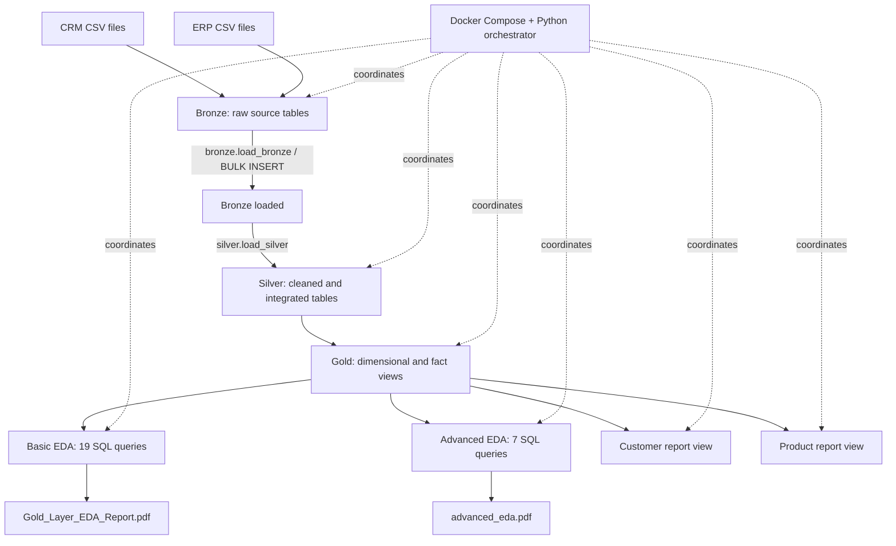
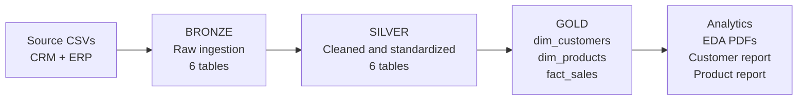
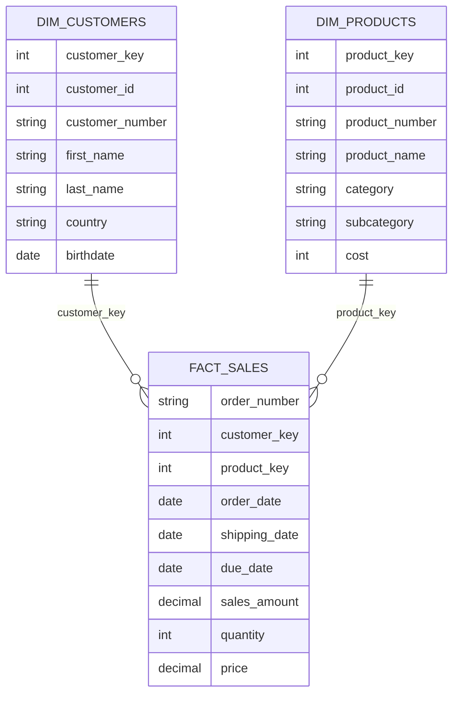
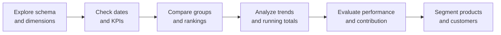
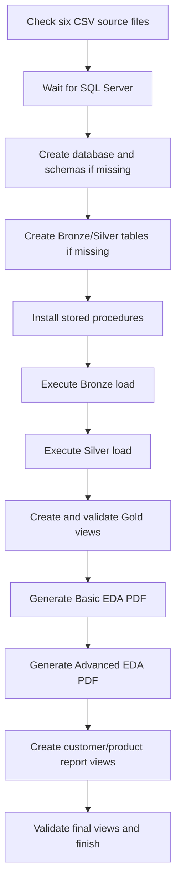

# SQL Data Warehouse | End-to-End SQL Analytics & Automated Reporting

**SQL Server 2022 · T-SQL · Medallion Architecture · Exploratory Data Analysis · Docker Compose · Python (automation and PDF reporting)**

An end-to-end **SQL-first data warehousing project** that transforms raw CRM and ERP CSV data into a structured analytics model. The primary data engineering and analysis work is implemented in **T-SQL**: bulk ingestion, data cleaning, integration, dimensional modeling, exploratory queries, and customer/product reporting. A small Python runner and Docker Compose make the workflow reproducible for people who do not use SQL Server Management Studio (SSMS).

> **Project status:** Development/demo. The Python files have been syntax-checked, but the full Docker + SQL Server + CSV integration has **not** been executed in the packaging environment. Run it with your actual dataset and review the results before treating the output as verified.

## Contents

- [Project objectives](#project-objectives)
- [Architecture and data flow](#architecture-and-data-flow)
- [What I implemented](#what-i-implemented)
- [Data model](#data-model)
- [Exploratory data analysis](#exploratory-data-analysis)
- [Final business reports](#final-business-reports)
- [Technology stack](#technology-stack)
- [Repository structure](#repository-structure)
- [Prerequisites](#prerequisites)
- [Quick start: Docker](#quick-start-docker)
- [Inspect results in SQL Server](#inspect-results-in-sql-server)
- [Rerun and troubleshooting](#rerun-and-troubleshooting)
- [Implementation details and limitations](#implementation-details-and-limitations)

## Project objectives

1. Consolidate customer, product, and sales information from separate CRM and ERP sources.
2. Build a layered **Bronze → Silver → Gold** warehouse in Microsoft SQL Server.
3. Clean and standardize source records with reusable T-SQL stored procedures.
4. Model analytics-ready customer and product dimensions alongside sales facts.
5. Explore data quality, customer demographics, sales trends, product performance, and revenue contributions using SQL.
6. Produce **Basic EDA** and **Advanced EDA** PDF reports and reusable SQL business-report views.
7. Allow other developers to reproduce the pipeline with Docker rather than executing every SQL script manually.

## Architecture and data flow

### Figure 1 — End-to-end warehouse pipeline



**Note:** The orchestrator checks source files, initializes missing database objects, installs stored procedures, then runs Bronze → Silver → Gold → EDA PDFs → final report views. The CSV data itself is not included in this package.

### Figure 2 — Medallion architecture



| Layer | Role | Main work |
|---|---|---|
| **Bronze** | Preserve ingested source data | Load six CSV files using SQL Server `BULK INSERT` |
| **Silver** | Prepare trustworthy analytical records | Clean, standardize, derive attributes, and integrate CRM/ERP data |
| **Gold** | Expose analysis-ready business data | Customer dimension, product dimension, and sales fact views |
| **Analytics** | Answer business questions | Basic/advanced SQL EDA and customer/product report views |

## What I implemented

### 1. Source ingestion — Bronze layer

The source data is organized into two systems:

| Source | CSV file | Bronze table |
|---|---|---|
| CRM | `cust_info.csv` | `bronze.crm_cust_info` |
| CRM | `prd_info.csv` | `bronze.crm_prd_info` |
| CRM | `sales_details.csv` | `bronze.crm_sales_details` |
| ERP | `CUST_AZ12.csv` | `bronze.erp_cust_az12` |
| ERP | `LOC_A101.csv` | `bronze.erp_loc_a101` |
| ERP | `PX_CAT_G1V2.csv` | `bronze.erp_px_cat_g1v2` |

The Bronze loader is defined in `scripts/bronze/bulkinsert_bronze.sql` as `bronze.load_bronze`. It truncates and reloads the six Bronze tables. During automated Docker execution, the Python runner patches the original Windows-specific dataset path to the container-mounted `/data/dataset/` path.

### 2. Data preparation — Silver layer

`scripts/silver/load_silver.sql` defines `silver.load_silver`, which refreshes the six Silver tables from Bronze and applies the project's T-SQL transformation logic. This is the preparation stage for cross-source joins and downstream analytical queries. The accompanying `scripts/silver/qa_silver.sql` contains SQL quality-assurance checks for manual review.

### 3. Dimensional modeling — Gold layer

`scripts/gold/ddl_gold.sql` defines three SQL **views** (not physically materialized dimension/fact tables):

- `gold.dim_customers`: customer identifiers, names, location, marital status, gender, birthdate, and creation date, assembled from Silver CRM/ERP data.
- `gold.dim_products`: current products, product hierarchy, category/subcategory, cost, product line, and start date. It filters `prd_end_dt IS NULL`.
- `gold.fact_sales`: order-level sales attributes linked to the customer and product dimensions.

### Figure 3 — Gold star-schema relationships



*Conceptual relationship diagram; the Gold objects are SQL views and the illustrated relationships are joins, not declared foreign-key constraints. The Gold view definitions use `LEFT JOIN`, so unmatched fact records can have null dimension keys.*

## Exploratory data analysis

The repository retains the original SQL analysis files:

- `scripts/eda_analysis.sql` — Basic EDA SQL queries.
- `scripts/eda_advanced.sql` — Advanced EDA SQL queries.

Two Python scripts run the analytical SQL and format query results into PDFs. **These are tabular PDF reports, not a dashboard or a collection of automatically generated charts.** The diagrams in this README explain the architecture and analytical workflow.

### Basic EDA — 19 queries

**Generator:** `scripts/generate_gold_eda_report.py`  
**Output:** `scripts/report/Gold_Layer_EDA_Report.pdf`

| Analysis area | Questions explored |
|---|---|
| Database and schema exploration | Gold objects and column metadata |
| Dimensional analysis | Countries, marital status, gender, product hierarchy |
| Date exploration | Order date boundaries; customer birthdate and age boundaries |
| Measures exploration | Core business KPIs |
| Magnitude analysis | Customers by country/gender; products and average cost by category; revenue by category/customer; items sold by country |
| Ranking analysis | Top/bottom products by revenue; top customers by revenue; customers with fewest orders |

### Advanced EDA — 7 queries

**Generator:** `scripts/generate_advanced_eda_report.py`  
**Output:** `scripts/report/advanced_eda.pdf`

| Analysis area | Questions explored |
|---|---|
| Change over time | Yearly and monthly sales trends |
| Cumulative analysis | Running sales totals and moving averages |
| Performance analysis | Product sales performance across years |
| Part-to-whole | Revenue contribution by product category |
| Data segmentation | Product cost bands and customer spending/lifespan segments |

### Figure 4 — Analytical progression



**PDF execution controls:** The Basic EDA generator contains **19 queries** and the Advanced EDA generator contains **7 queries**. Both limit displayed results to **20 rows per query** and use a default **60-second timeout per query**. A timed-out or failed query may be marked as skipped while the rest of the PDF is still produced. Check report warnings and terminal output; a generated PDF does not necessarily mean every query succeeded.

## Final business reports

After EDA, the pipeline creates two reusable SQL report views:

- **`gold.report_customers`** — customer-level sales and purchasing metrics.
- **`gold.report_products`** — product-level sales and performance metrics.

These are queryable SQL views, suitable as a starting point for subsequent analysis or BI tools. They are **not** additional PDFs.

```sql
USE SQLDataWarehouse;
GO

SELECT TOP (20) * FROM gold.report_customers;
SELECT TOP (20) * FROM gold.report_products;
```

## Technology stack

| Technology | Purpose |
|---|---|
| Microsoft SQL Server 2022 | Database and T-SQL execution |
| T-SQL | ETL stored procedures, cleaning, joins, views, and analytics |
| Docker Compose | Reproducible SQL Server and pipeline services |
| Python 3.12 | Pipeline orchestration and PDF generation |
| `pyodbc` / Microsoft ODBC Driver 18 | SQL Server connectivity inside the Python container |
| ReportLab | PDF tables and report formatting |
| SSMS (optional) | Manual SQL exploration and inspection |

**No `uv` or Python virtual environment is required on the host** for the Docker workflow. Python dependencies are installed **inside** the pipeline image using `pip` and `requirements.txt`.

## Repository structure

```text
SQLWarehouse_Automated/
├── dataset/                         # Supply the six CSV files (not bundled)
│   ├── source_crm/
│   └── source_erp/
├── scripts/
│   ├── bronze/
│   │   ├── ddl_bronze.sql
│   │   └── bulkinsert_bronze.sql
│   ├── silver/
│   │   ├── ddl_silver.sql
│   │   ├── load_silver.sql
│   │   └── qa_silver.sql
│   ├── gold/
│   │   ├── ddl_gold.sql
│   │   ├── report_customers.sql
│   │   └── report_products.sql
│   ├── eda_analysis.sql
│   ├── eda_advanced.sql
│   ├── generate_gold_eda_report.py
│   ├── generate_advanced_eda_report.py
│   └── report/                       # Generated PDFs
├── pipeline/                         # Reserved folder; currently empty
├── output/                           # Reserved folder; currently empty
├── run_pipeline.py                   # Actual orchestration entry point
├── Dockerfile
├── docker-compose.yml
├── requirements.txt
├── .env.example
├── .gitignore
└── README.md
```

> The current release uses **one** `run_pipeline.py` for database access, SQL execution, validation, and orchestration. The previously proposed `pipeline/database.py`, `executor.py`, `validation.py`, and `orchestrator.py` modules have **not** been implemented; they are not required to run this version.

## Prerequisites

- Docker Desktop running in **Linux containers** mode, with Docker Compose v2.
- Enough free memory for SQL Server (around **4 GB available** is a useful starting point).
- The six CSV files in the expected locations below.
- A private strong SQL Server `sa` password for the **Docker** instance.

### Expected source files

```text
dataset/
├── source_crm/
│   ├── cust_info.csv
│   ├── prd_info.csv
│   └── sales_details.csv
└── source_erp/
    ├── CUST_AZ12.csv
    ├── LOC_A101.csv
    └── PX_CAT_G1V2.csv
```

The files are mounted read-only into SQL Server at `/data/dataset/`. The Python runner checks for the expected files before beginning the ETL. The database container, not just the Python container, must be able to read the CSVs.

## Quick start: Docker

Open **PowerShell** in the repository root.

### 1. Create a local configuration

```powershell
Copy-Item .env.example .env
```

Edit `.env` and replace the sample value with **your own strong private password**:

```dotenv
MSSQL_SA_PASSWORD=ChooseYourOwnStrongPassword123!
SQL_PORT=14333
ETL_QUERY_TIMEOUT=600
PDF_STAGE_TIMEOUT=1500
```

**Why a password?** Your existing local SQL Server may use Windows Authentication. The Docker image starts a **separate Linux SQL Server instance** and uses SQL authentication with the built-in `sa` login. No external account registration is required. Never commit `.env` to GitHub.

### 2. Check Docker

```powershell
docker --version
docker compose version
docker info
```

### 3. Start SQL Server

```powershell
docker compose up -d sqlserver
docker compose ps
```

For startup messages:

```powershell
docker compose logs --tail 50 sqlserver
```

### 4. Run the full pipeline

```powershell
docker compose --profile run run --build --rm pipeline
```

The first `run` is the **Compose profile name**; the second `run` is the **Compose command**. `--build` builds the Python image, and `--rm` removes the one-off pipeline container after it finishes. It does **not** delete the SQL Server data volume.

### Figure 5 — What happens when you run the command



**Expected PDF outputs:**

```text
scripts/report/Gold_Layer_EDA_Report.pdf
scripts/report/advanced_eda.pdf
```

## Inspect results in SQL Server

Use SSMS or another compatible SQL Server client:

| Setting | Value |
|---|---|
| Server | `localhost,14333` (or the port configured in `.env`) |
| Authentication | SQL Server Authentication |
| Username | `sa` |
| Password | Your `.env` password |
| Database | `SQLDataWarehouse` |
| Encryption | Trust the local development server certificate |

```sql
USE SQLDataWarehouse;
GO

SELECT TOP (20) * FROM gold.dim_customers;
SELECT TOP (20) * FROM gold.dim_products;
SELECT TOP (20) * FROM gold.fact_sales;
SELECT TOP (20) * FROM gold.report_customers;
SELECT TOP (20) * FROM gold.report_products;
```

## Rerun and troubleshooting

**Rerun with the existing Python image:**

```powershell
docker compose --profile run run --rm pipeline
```

**Rebuild after changing Python code or dependencies:**

```powershell
docker compose --profile run run --build --rm pipeline
```

**Skip PDF generation:**

```powershell
docker compose --profile run run --rm pipeline python run_pipeline.py --skip-pdf
```

**Inspect services and logs:**

```powershell
docker compose ps
docker compose logs sqlserver
```

**Stop the Compose stack:**

```powershell
docker compose down
```

Do **not** use `docker compose down -v` unless you deliberately want to remove the persistent SQL Server volume.

### Common problems

| Symptom | Check |
|---|---|
| `MSSQL_SA_PASSWORD is missing` | Create `.env` beside `docker-compose.yml` and set a nonempty `MSSQL_SA_PASSWORD` |
| SQL Server does not start | Docker Desktop status, memory, SQL Server logs, and password complexity |
| Missing CSV file | Exact filename, capitalization, and `dataset/source_crm` / `dataset/source_erp` location |
| `BULK INSERT` fails | Dataset mount and permissions; SQL Server reads the files **inside its container** |
| Host port is occupied | Change `SQL_PORT` in `.env` and connect SSMS using that port |
| PDF not generated | Review pipeline output, SQL query timeouts, and the `scripts/report/` folder |
| `DATETRUNC` error | Confirm the database is running SQL Server 2022 or newer |

## Implementation details and limitations

- **Non-destructive initialization:** The runner creates the database and schemas if missing. It creates an entire Bronze or Silver table layer only when **none** of its six tables exists; it stops if it detects a partially initialized layer.
- **Repeatable loading, not transactional refresh:** The original Bronze and Silver procedures truncate and reload tables. They are **not atomic across all six tables**, so an error can leave partial data. Use only for development/demo data until a transactional or staging-table strategy is implemented.
- **Stored procedure installation:** The runner installs or refreshes stored procedure definitions without running their trailing `EXEC` statements twice.
- **Validation scope:** The runner checks expected objects exist and performs `SELECT TOP (1)` on Gold and final report views. It does **not** automatically execute every query in `qa_silver.sql` or `qa_gold.sql`, nor does it implement comprehensive data-quality assertions.
- **Dynamic surrogate keys:** Gold dimension views use `ROW_NUMBER()` to derive keys. These keys can shift if the source data changes; persisted surrogate keys are preferable for production.
- **Reconstructed Gold SQL:** `ddl_gold.sql` and the customer/product report view definitions were reconstructed from SQL shared in the conversation rather than uploaded original files. Compare them with the canonical versions before publishing.
- **EDA timeouts:** Each PDF generator limits queries to 60 seconds by default and shows up to 20 rows. Individual queries may be skipped without failing the entire PDF generation process.
- **SQL Server version:** The advanced EDA uses `DATETRUNC`, which requires SQL Server 2022 or later.
- **CSV parsing:** The Bronze loader retains comma-delimited `BULK INSERT` behavior; it is not a fully RFC-compliant quoted-CSV parser.
- **Security:** This configuration is intended for local development. Do not publish the SQL Server port to the public internet or commit credentials.
- **Testing:** The full pipeline has not been integration-tested here against the actual CSV dataset and a live Docker SQL Server instance.

## Future enhancements

- Extract the monolithic runner into `pipeline/database.py`, `executor.py`, `validation.py`, and `orchestrator.py`.
- Automate Silver/Gold data-quality assertions and produce a validation summary.
- Add transactional/staged refreshes and durable pipeline logs.
- Add CI tests and optional BI dashboards (for example, Power BI).

---

**Project focus:** SQL data engineering, dimensional modeling, SQL analytics, and reproducible reporting. Python and Docker support the workflow; the warehouse transformations and business analysis remain SQL-first.
